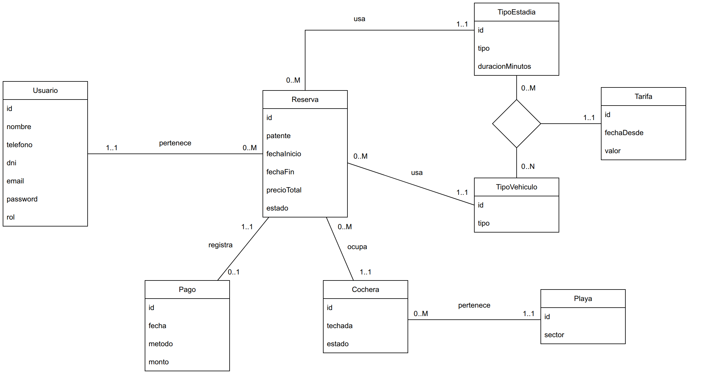

# Propuesta TP DSW

## Grupo
### Integrantes
* 50672 Martin Pilaszek
* 50336 Lazaro Cerquetti
* 48784 Bruno Cussitt

### Repositorios
* [frontend app](https://github.com/mapszk/dsw-frontend)
* [backend app](https://github.com/mapszk/dsw-api)

## Tema
### Descripción
Aplicacion para gestion de reservas en un estacionamiento. Comprende la alta de usuarios, gestion de playas de estacionamientos, cocheras, reservas, tarifas y pagos.

### Modelo

Diferencias con el DER original, necesarias para la funcionalidad de la app:
* `Usuario.rol` (ADMIN / CLIENTE): permite los 2 niveles de acceso.
* `TipoEstadia.duracionMinutos`: permite calcular el precio total de la reserva.
* `id` en Reserva y Pago.
* `Usuario` - `Reserva` pasa a 0..M del lado de la reserva (un administrador no tiene reservas).

## Alcance Funcional 

### Alcance Mínimo

|Req|Detalle|
|:-|:-|
| CRUD Simple | 1. CRUD Usuario 2. CRUD TipoVehiculo 3. CRUD TipoEstadia 4. CRUD Playa |
| CRUD Dependiente | 1. CRUD Cochera depende de Playa 2. CRUD Tarifa depende de TipoVehiculo y TipoEstadia 3. CRUD Reserva depende de Usuario, Cochera, TipoVehiculo y TipoEstadia 4. CRUD Pago depende de Reserva |
| Listado + detalle | 1. Listado de cocheras filtrado por playa (y por estado y techo) => al seleccionar una cochera redirige a su CRUD: muestra su estado (disponible, ocupada o inhabilitada) y permite editar su playa, si es techada y su estado, o eliminarla 2. Listado de reservas filtrado por estado => detalle muestra la reserva, usuario, cochera y pago |
| CUU/Epic | 1. Crear una reserva: valida disponibilidad de cochera y solapamiento de fechas, calcula el precio según la tarifa vigente para el tipo de vehículo y tipo de estadía 2. Registrar el pago de una reserva: a partir de una reserva creada (CUU 1) y aprobada por un administrador, registra el pago y la reserva pasa a pagada 3. Reprogramar una reserva: a partir de una reserva creada (CUU 1), cambia las fechas, revalida disponibilidad (reasignando cochera si es necesario) y recalcula el precio |

Adicionales para Aprobación
| Req | Detalle |
|:-|:-|
| Funcionalidad adicional | 1. Login con roles administrador y cliente, con rutas protegidas según el rol 2. Cancelar una reserva pendiente o activa (el administrador en cualquier momento; el cliente, las suyas y antes de la fecha de inicio) 3. Gestión de estado de reserva: pendiente => activa (aprobada por un administrador) => pagada, o cancelada. La cochera queda ocupada solo durante el horario de cada reserva |

### Alcance Adicional Voluntario

| Req | Detalle |
|:-|:-|
| Listados | 1. Listado de cocheras disponibles por fecha 2. Reporte de ingresos por día 3. Historial de reservas por usuario |
| CUU / Epic | 1. Reasignación de cochera |
| Otros | 1. Exportación de reportes (CSV o PDF) 2. Notificación simple de reservas (opcional) |

## Distribución de tareas

| Integrante | CRUDs | Listado + detalle | CUU/Epic | Tests |
|:-|:-|:-|:-|:-|
| Martin Pilaszek | Reserva, TipoEstadia | Reservas filtrado por estado | 1. Crear una reserva | Test unitario backend (cálculo de precio y solapamiento) + test de integración backend |
| Lazaro Cerquetti | Playa, Cochera, Pago | Cocheras filtrado por playa | 2. Registrar el pago de una reserva | Test unitario backend (registro del pago) + test unitario de componente frontend |
| Bruno Cussitt | Usuario, TipoVehiculo, Tarifa | - | 3. Reprogramar una reserva | Test unitario backend (reprogramación) + test end-to-end frontend |

Los CUU 2 y 3 se relacionan con el CUU 1, ya que operan sobre la reserva registrada por éste. El login y la protección de rutas por rol quedan a cargo de Bruno junto con el CRUD de Usuario.
